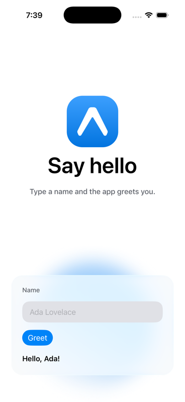
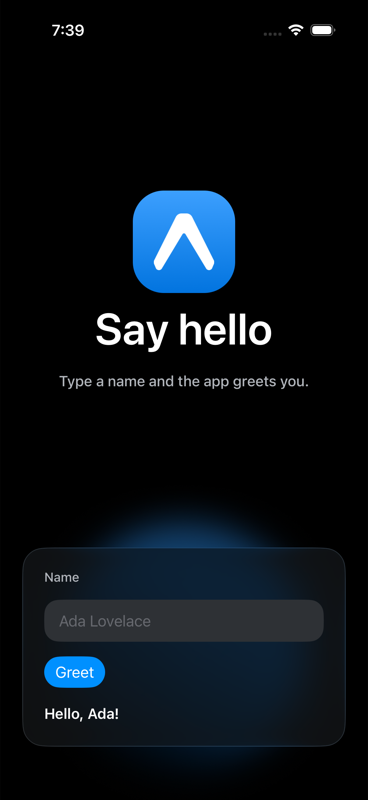
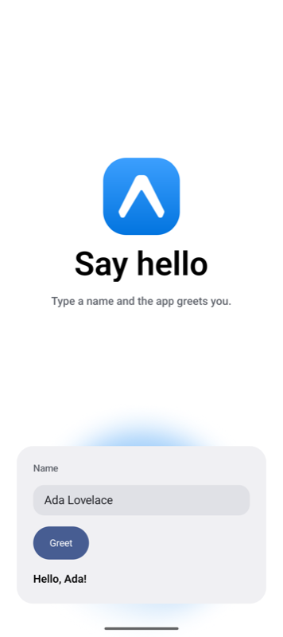

# e2e Tests on Expo Simulators Example

<p>
  <!-- iOS -->
  
  <!-- Android -->
  
  <!-- Web -->
  
</p>

An Expo app with five e2e tests by TesterArmy. The tests run on the simulator on your computer, on Expo Simulators with no Mac or Android SDK, and in EAS Workflows on every pull request.

The form uses Expo UI universal components, so the tests drive SwiftUI on iOS and Jetpack Compose on Android instead of React Native views.

## Launch your own

[](https://launch.expo.dev/?github=https://github.com/expo/examples/tree/master/with-e2e)

<p>
  
  
  
</p>

## 🚀 How to use

```bash
npx create-expo --example with-e2e
cd with-e2e
```

Use Node 22.12 or later. The app needs a build. Expo Go does not run it.

### Run the tests on your computer

| Platform | Build and install | Run the tests |
| --- | --- | --- |
| iOS | `npm run ios:release` | `npm run test:e2e:ios` |
| Android | `npm run android:release` | `npm run test:e2e:android` |
| Web | `npx playwright install chromium` once. The runner starts Expo. | `npm run test:e2e:web` |

For native builds, follow [Expo's setup guide](https://docs.expo.dev/get-started/set-up-your-environment/). Start a simulator or emulator before you build. Rebuild after app changes. Results are in `.e2e/report.json`.

### Run the tests on Expo Simulators

Expo Simulators is in limited access. Check your account:

```bash
npx eas-cli@latest simulator:availability
```

Link the project and make a simulator build with the `e2e` profile:

```bash
npx eas-cli@latest init
npx eas-cli@latest build --platform ios --profile e2e
```

Then run the suite with the build id. The provider leases a hosted simulator, EAS installs the build on it, and the tests drive it:

```bash
E2E_IOS_BUILD_ID=<build id> npm run test:e2e:ios
```

Android works the same way with `--platform android` and `E2E_ANDROID_BUILD_ID`. The provider authenticates with `EXPO_TOKEN` or your `eas login`. Each session takes about three minutes to start and counts toward your account's limits. See [e2e's EAS Simulators guide](https://e2e.tester.army/docs/integrations/eas) for the options.

### Run the tests in EAS Workflows

`.eas/workflows/e2e.yml` builds the app for iOS and Android, then runs the suite on Expo Simulators from Linux runners. It runs on every pull request and on pushes to `main`.

One-time setup:

1. [Connect the GitHub repository](https://docs.expo.dev/eas/workflows/get-started/) to the EAS project.
2. Add `EXPO_TOKEN`, a [robot token](https://docs.expo.dev/accounts/programmatic-access/) with access to the project, as a secret in the `preview` EAS environment.
3. Optional: add `AI_GATEWAY_API_KEY` to the same environment to run the agent tests.

Run it by hand:

```bash
npx eas-cli@latest workflow:run .eas/workflows/e2e.yml
```

### The tests

`tests/deterministic.e2e.ts` finds elements by `testID` and checks the greeting and the empty-name error. `tests/agentic.e2e.ts` gives an agent a goal in plain language, then checks the result with a locator. The agent tests need a [Vercel AI Gateway](https://vercel.com/docs/ai-gateway) key. Without it, they skip:

```bash
AI_GATEWAY_API_KEY="your-key" npm run test:e2e:ios
```

Coding agents: read [`AGENTS.md`](AGENTS.md) before changing the screen or the tests.

## 📝 Notes

- [Using e2e by TesterArmy](https://docs.expo.dev/guides/using-e2e/)
- [Expo Simulators](https://expo.dev/services/simulators)
- [EAS Workflows](https://docs.expo.dev/eas/workflows/introduction/)
- [Expo UI](https://docs.expo.dev/versions/latest/sdk/ui/universal/) and [Liquid Glass](https://docs.expo.dev/versions/latest/sdk/glass-effect/)
- [Expo skills](https://docs.expo.dev/skills) for coding agents

Last checked on 2026-10-29 with Expo SDK 58.
